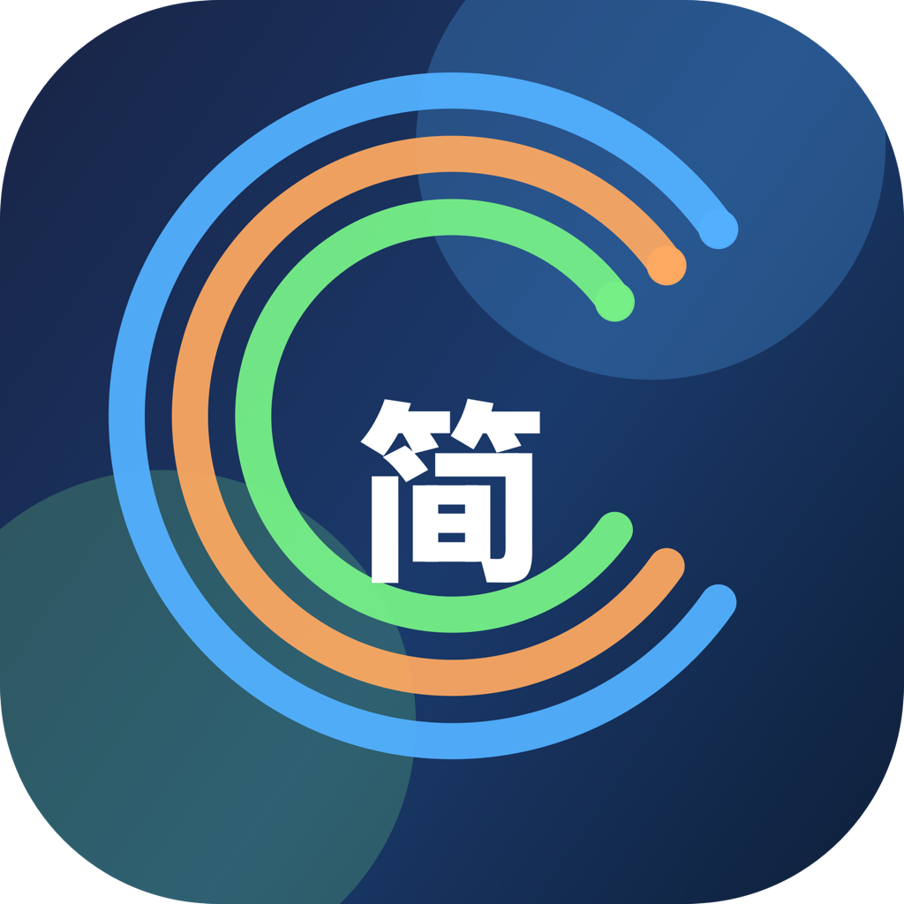

<p align="center"><a href="https://larryhu.com/simpleworth/"><picture><source media="(prefers-color-scheme: dark)" srcset="Sources/Assets.xcassets/AppIcon.appiconset/AppIcon-dark-1024.png"></picture></a></p>
<h1 align="center">SimpleWorth · 简值</h1>
<p align="center"><strong>记得简单，心里有数。</strong></p>
<p align="center"><a href="https://apps.apple.com/app/id6761478113">App Store 免费下载 ↗</a> · <a href="https://larryhu.com/simpleworth/">完整介绍与交互预览 ↗</a> · <a href="README.en.md">English</a></p>

<p align="center"><a href="https://apps.apple.com/app/id6761478113"><picture>
  <source media="(prefers-color-scheme: dark)" srcset="https://raw.githubusercontent.com/LarryHu1988/LarryHu1988.github.io/93aecb644e70b257fafb083d46d8510d7fa01b05/simpleworth/assets/github/zh-hero-dark.png">
  <source media="(prefers-color-scheme: light)" srcset="https://raw.githubusercontent.com/LarryHu1988/LarryHu1988.github.io/93aecb644e70b257fafb083d46d8510d7fa01b05/simpleworth/assets/github/zh-hero-light.png">
  
</picture></a></p>

<p align="center">免费 · 无广告 · iPhone / iPad · iOS 17+</p>

<p align="center"><a href="https://larryhu.com/simpleworth/"><picture>
  <source media="(prefers-color-scheme: dark)" srcset="https://raw.githubusercontent.com/LarryHu1988/LarryHu1988.github.io/93aecb644e70b257fafb083d46d8510d7fa01b05/simpleworth/assets/github/zh-features-dark.png">
  <source media="(prefers-color-scheme: light)" srcset="https://raw.githubusercontent.com/LarryHu1988/LarryHu1988.github.io/93aecb644e70b257fafb083d46d8510d7fa01b05/simpleworth/assets/github/zh-features-light.png">
  
</picture></a></p>

## 清透一点，轻松一点。

柔和的蓝色渐变、通透的玻璃卡片、绿橙蓝粉四色。支出、收入、金库、统计，给日常刚刚好的空间。

<p align="center">
<a href="https://larryhu.com/simpleworth/"></a>
<a href="https://larryhu.com/simpleworth/"></a>
<a href="https://larryhu.com/simpleworth/"></a>
<a href="https://larryhu.com/simpleworth/"></a>
</p>

<p align="center"><sub>真实应用界面，截图使用演示数据。</sub></p>

<details>
<summary><strong>功能说明 · 阅读文字版</strong></summary>

- **支出与收入**：分类、多标签、备注和月份筛选。账目支持编辑、复制和删除，支出支持退款；输入金额时直接进行加、减、乘、除。
- **金库**：设置目标金额与可选期限，记录每次存入，查看储蓄进度。
- **统计**：收入、支出、净结余、储蓄率、月度趋势；点击分类或标签圆环联动查看记录。
- **多币种**：常用币种、本位币折算与汇率刷新，汇率仅作记账参考。
- **外观与语言**：浅色、深色或跟随系统；简体中文、繁體中文、English、日本語。
- **屏幕适配**：支持 iPhone 与 iPad，按可用空间调整布局；宽屏工作区为记录和图表提供更多空间。

</details>

## 你的账本，由你掌握。

核心记账离线可用，账目默认保存在设备上，无需注册 App 账户。App 不集成广告或跨 App 跟踪 SDK，不把账目上传到开发者自有服务器。

你可以主动开启 **iCloud 自动备份**，也可以导出和恢复数据。iCloud 提供备份与恢复，**不是实时双向合并账本**。恢复会覆盖当前设备数据；汇率更新需要网络。

[隐私与数据处理 ↗](https://larryhu.com/simpleworth/privacy/)

## 从今天的一笔开始。

[**在 App Store 免费下载 SimpleWorth ↗**](https://apps.apple.com/app/id6761478113) · [产品介绍](https://larryhu.com/simpleworth/) · [技术支持](https://larryhu.com/simpleworth/support/) · [隐私政策](https://larryhu.com/simpleworth/privacy/)

反馈问题请使用[问题反馈模板](https://github.com/LarryHu1988/SimpleWorth/issues/new/choose)或联系 [simpleworth@larryhu.com](mailto:simpleworth@larryhu.com)。截图请遮挡私人账目。详见[支持说明](SUPPORT.md)。

<details>
<summary><strong>开发与验证</strong></summary>

SwiftUI · SwiftData · Swift Charts · XcodeGen。最低 iOS / iPadOS 17。

```sh
xcodegen generate
open SimpleWorth.xcodeproj
```

[开发与隔离测试](docs/DEVELOPMENT.md) · [开发协作](CONTRIBUTING.md)

Duo 外屏倒置竖屏的已知限制在开发说明中记录。

</details>

<p align="center"><sub>© 2026 Larry Hu. All rights reserved.</sub></p>
