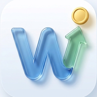
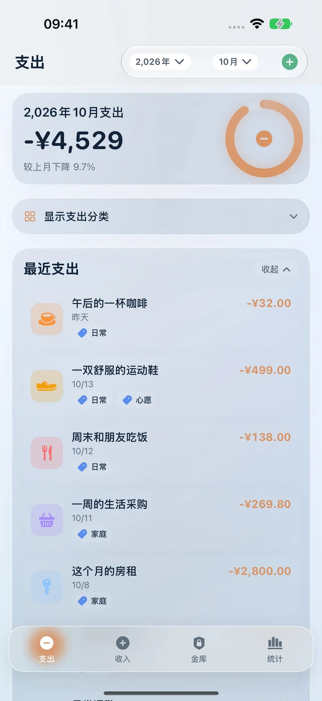
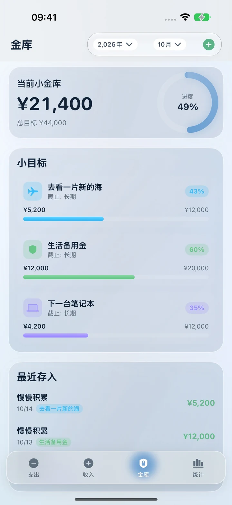
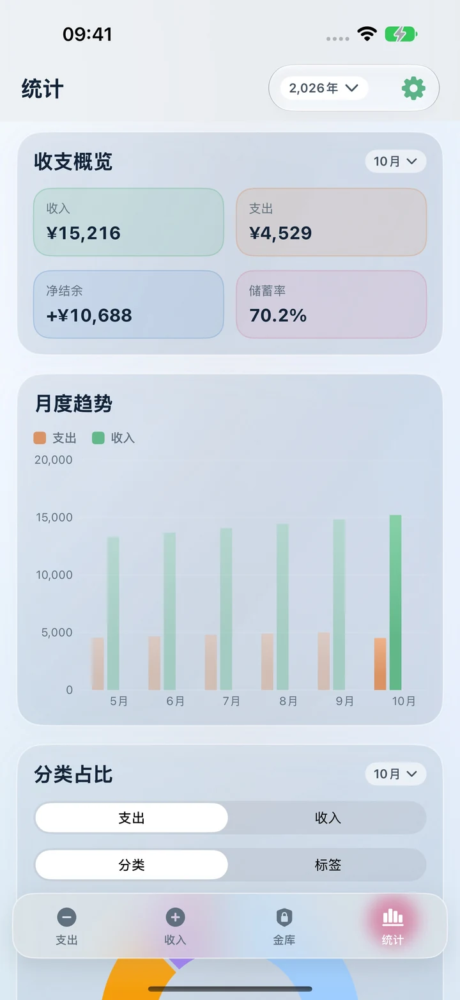
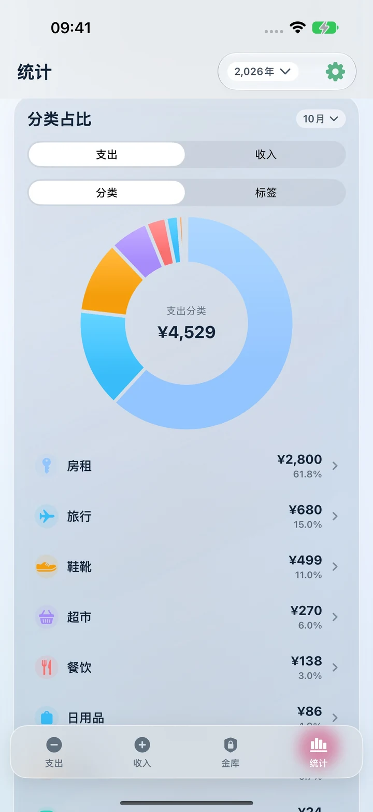

<div align="center">


# SimpleWorth · 简值

### 记得简单，心里有数。

轻松记录收支，看清日常流向，慢慢存下小目标。

**1.0** · 免费 · 无广告 · iPhone / iPad · iOS 17+

[App Store 免费下载](https://apps.apple.com/app/id6761478113) · [产品介绍](https://larryhu.com/simpleworth/) · [English](README.en.md)

</div>

---

## 为日常留一点从容

SimpleWorth 是一款本地优先的记账与储蓄目标 App。柔和的蓝色渐变、通透的玻璃卡片，以及绿、橙、蓝、粉四色，让收支、目标与统计各有位置。

| 支出 | 收入 | 金库 | 统计 |
| --- | --- | --- | --- |
| 分类、标签与备注，整理日常消费 | 按月记录与回看每一份进账 | 设置目标、记录存入、查看进度 | 收支概览、月度趋势、分类与标签占比 |

<p align="center">




</p>

<p align="center"><sub>真实应用界面，截图使用演示数据。</sub></p>

## 1.0 的日常工具

- **记账顺手**：支出与收入分类、多标签、备注、日期筛选；账目支持编辑、复制和删除，支出支持退款。
- **金额直接算**：输入时使用加、减、乘、除，减少来回切换。
- **统计看得清**：月度收入与支出趋势、净结余、储蓄率；点击圆环联动查看分类或标签记录。
- **小目标慢慢存**：目标金额、可选期限、存入记录与进度展示。
- **多币种记录**：常用币种、本位币折算与汇率刷新。汇率仅供记账参考。
- **外观由你选**：浅色、深色或跟随系统；支持简体中文、繁體中文、English、日本語。
- **适配不同空间**：iPhone、iPad 随可用宽度调整；宽屏工作区为记录和图表提供更多空间。

## 数据由你掌握

核心记账离线可用，无需注册 App 账户。账目默认保存在本机，不上传到开发者自有服务器。App 不集成广告或跨 App 跟踪 SDK。

iCloud 自动备份由你选择开启，用于保存备份并在同一 Apple 账号下恢复，**不是实时双向账本合并**。支持文件导入、导出和备份管理。恢复备份会覆盖当前设备数据，请先保留当前备份。汇率更新需要联网，相关第三方请求详见[隐私政策](https://larryhu.com/simpleworth/privacy/)。

## 下载与支持

- [App Store：SimpleWorth 1.0](https://apps.apple.com/app/id6761478113)
- [产品介绍](https://larryhu.com/simpleworth/) · [技术支持与常见问题](https://larryhu.com/simpleworth/support/) · [隐私政策](https://larryhu.com/simpleworth/privacy/)
- 联系作者：[simpleworth@larryhu.com](mailto:simpleworth@larryhu.com)

反馈问题时请附 App 版本、设备型号、系统版本和复现步骤，截图中请遮挡私人账目。

## 开发与验证

使用 SwiftUI、SwiftData、Swift Charts 和 XcodeGen，最低系统版本为 iOS / iPadOS 17。项目版本与构建号为 **1.0 (1)**。

```sh
xcodegen generate
open SimpleWorth.xcodeproj
```

模拟器无需签名构建：

```sh
DEVELOPER_DIR=/Applications/Xcode.app/Contents/Developer \
xcodebuild -project SimpleWorth.xcodeproj -scheme SimpleWorth \
  -configuration Release -sdk iphonesimulator \
  -derivedDataPath /tmp/SimpleWorth-build CODE_SIGNING_ALLOWED=NO build
```

真机调试需配置自己的签名与 iCloud 容器。[开发说明与测试入口](docs/DEVELOPMENT.md)包含隔离测试方式及已知布局限制。

本仓库仅保留 **1.0** 的 Release 与版本标签。日常开发准备文件与生成的验收材料不纳入产品介绍。

© 2026 Larry Hu. All rights reserved.
